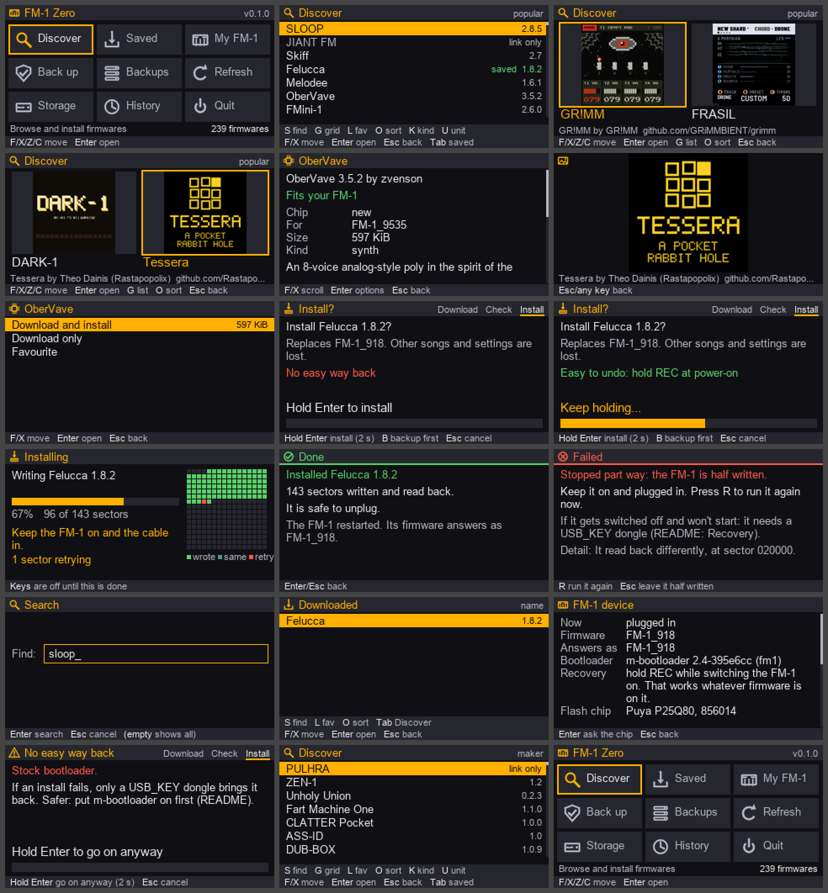

# fm1-zero

An M-VAVE FM-1 firmware manager for the **M5Stack CardputerZero**. Browse The Firmware Hub's list, download a
firmware from its maker, back the FM-1 up, and install or restore over one USB cable, from the CardputerZero's own
screen and keyboard. No computer needed.

It is [lilfm1buddy](https://github.com/konsumer/lilfm1buddy) and [fm1-flip](https://github.com/chrisdiana/fm1-flip)
for a different device. Those run on ESP32 boards. The CardputerZero is a small Linux computer (Raspberry Pi CM0), so
this is a Python app instead of firmware.



The firmware pictures in the screenshots are the makers' own work, taken from The Firmware Hub's list. Each one is
credited on screen with its maker's name and repository. See the note on pictures under
[Using the app](#using-the-app).

**Status: run on one real FM-1** (an older-flash-chip unit with m-bootloader). On it, `status`, `info` and `backup`
work, and a backup is byte-for-byte the same as M-Flasher's of the same unit. Restoring an identical image writes
nothing, and a real install of SLOOP worked. The logic also passes 85 tests against a pretend FM-1.

Not proven yet: SMK-37 keyboards, the newer flash chip (`0xB36014`), the recovery paths (REC at power-on, the
MIDI-mode recovery menu) and an install that stops part way. Follow
[First run](#first-run-prove-it-in-this-order) on your own unit before trusting it.

## What it can and can't do

| | |
|---|---|
| Browse, search, sort and favourite the Hub's firmwares, as a list or a grid of pictures | yes |
| Download a package from its maker's GitHub release, checked by size and SHA-256 | yes |
| Use `.fwsc` files you copy on by hand | yes |
| Show each firmware's own picture (`P` on its page), with its maker's name and repository | yes, needs internet the first time |
| Back up the whole 1 MiB flash (read twice, compared) | yes |
| Download and install in one go, or install a package you already have; restore a backup | yes |
| Show the flash's 256 sectors as it goes, on the CardputerZero and on the FM-1's own screen | yes |
| SMK-37 keyboards (the FM-1's chip in a keyboard) | the rules are there, untested |
| Say which bootloader the FM-1 has, and how it would be recovered | yes |
| Force an FM-1 into download mode when nothing on it runs | no: see Recovery |

## Recovery: set this up before the first install

Everything is written through "download mode", a boot loader in the FM-1's chip that no firmware can break. The
question is only how the FM-1 gets there when things have gone wrong.

| Way in | Works when | Needs |
|---|---|---|
| A MIDI message (what fm1-zero sends by itself) | stock firmware or Felucca is running | nothing |
| Hold **OCT-** and **OCT+** for 5 s | Felucca, SLOOP or Snoop37 is running | nothing |
| Hold **REC** while switching on | always, firmware or no firmware | [m-bootloader](https://github.com/jvitkauskas/m-bootloader) on the FM-1 |
| USB_KEY dongle | always, even with a broken bootloader | a Raspberry Pi Pico, wired up |

With the **stock bootloader**, an install that dies half way can leave an FM-1 that won't start, and then only the
dongle gets it back. With **m-bootloader**, you hold REC and install again. So:

1. Put [M-Flasher](https://github.com/jvitkauskas/m-flasher) on the CardputerZero. It is the proven tool for this
   chip, it has a build for 64-bit Raspberry Pi OS, and it works from the command line:
   `sudo apt install ./m-flasher_..._arm64.deb`, then `m-flasher info`. It is your recovery tool if fm1-zero itself
   is what's broken.
2. `m-flasher backup`. Copy the backup off the CardputerZero.
3. `m-flasher bootloader` installs m-bootloader. **Check the flash chip first** (`m-flasher info`, or FM-1 device in
   fm1-zero). On the newer chip (`0xB36014`, FM-1s from late 2026) m-bootloader is little tested and one unit did not
   start after an early version. That is the one step here that can need a dongle, so on that chip decide with care.
4. From then on fm1-zero shows "m-bootloader" under FM-1 device, and the install question says "hold REC" instead of
   warning you.

What fm1-zero does about it (the first two after [M-Flasher +](https://github.com/wellingtonsaam/m-flasher-plus)):

- **Before an install on a stock-bootloader FM-1** it stops on a screen of its own, "No easy way back", and wants
  Enter held there before it even asks the install question. On an FM-1 it hasn't checked yet, it sends you to
  check it first.
- **When the firmware doesn't know the download-mode message**, it says which keys to hold and waits a minute
  for the FM-1 to show up, then carries on by itself.
- **It remembers what it installed.** Many firmwares call themselves "FM-1_918" or the name of the one they were
  built from. FM-1 device shows the name you chose it by, for as long as the unit still answers the same. (This is a
  note of what was installed, not a fingerprint of the flash: another tool changing the firmware to one that answers
  the same would not be noticed.) Backups are named by it too.

Things to know:

- fm1-zero never writes the bootloader. Installing or removing it is M-Flasher's job.
- M-VAVE's official updates and Baud Girl's installer put the stock bootloader back. Reinstall m-bootloader after them.
- With m-bootloader, a damaged firmware opens its recovery menu in "MIDI mode". fm1-zero sees that as an FM-1 and
  can send it on to download mode by itself. Not tried on hardware yet.
- If an install stops part way, keep the FM-1 on and run the same install again: fm1-zero tries again by itself up
  to three times, then leaves the FM-1 in download mode. Whether it waits there for long with nothing sent has not
  been checked, so run it again straight away.
- M-Flasher and fm1-zero both talk to download mode. Use one at a time, and replug the FM-1 when you switch tools:
  fm1-zero takes the USB device away from the Linux disk driver that M-Flasher uses.

## What is never written

- Below `0x4000` (what the chip starts from) and from `0xFF000` up (its key and MAC). Checked before and after.
- An SMK-37's calibration sector (`0xC1000`).
- An FM-1's files onto an SMK-37, or the other way round.
- Anything onto a chip this tool doesn't recognise (key `980F`, one of three known 1 MiB flash parts).
- A firmware the Hub marks `chip: old` onto an FM-1 with the newer flash chip.
- A sector that already holds the right bytes. Each written sector is read back.

## Set it up

Copy this folder to the CardputerZero (scp, or the SD card), then on the CardputerZero:

```sh
sh setup-on-zero.sh
```

That installs Python's Pillow, numpy, evdev and pyusb, and a udev rule so you can reach the FM-1's boot loader
without root. Log out and in again afterwards.

To make it an app in the CardputerZero's launcher, build a `.deb` on the CardputerZero itself:

```sh
sh packaging/build-deb.sh
sudo apt install ./fm1-zero_*_all.deb
```

It needs only `dpkg-deb`. It installs the app as "FM-1 Zero" in the launcher, with the udev rule, so no log out is
needed. The version comes from `packaging/meta.env`.

## First run: prove it in this order

Do [Recovery](#recovery-set-this-up-before-the-first-install) first. Then do these over SSH, with the FM-1 plugged into the CardputerZero by a data cable and switched on. Each step risks
more than the one before, so stop at the first one that goes wrong and send me what it printed.

1. `python3 -m unittest discover -s tests -t .` : the 85 tests pass on the CardputerZero itself.
2. `python3 -m fm1zero status` : lists MIDI devices and what the FM-1 says it is. Writes nothing, restarts nothing.
3. `python3 -m fm1zero info` : sends the FM-1 to its boot loader, loads the flash loader into its RAM, asks the chip
   what it is, and restarts it. Writes nothing to flash. This proves the whole USB path.
4. `python3 -m fm1zero backup` : reads the flash twice and saves it. Still nothing written. Copy the file somewhere
   safe.
   Compare it with M-Flasher's backup of the same unit (`sha256sum`): the same bytes means fm1-zero reads this
   chip correctly.
5. `python3 -m fm1zero backup` again : the two files should be identical (`sha256sum backups/*.bin`).
6. `python3 -m fm1zero refresh`, then `python3 -m fm1zero get felucca` : the download path.
7. `python3 -m fm1zero install ~/.local/share/fm1zero/packages/felucca-1.8.2.fwsc` : the first real write. Felucca
   answers the boot loader message, so you can still switch away afterwards.
8. `python3 -m fm1zero restore <your backup>` : back to where you started.
9. `python3 -m fm1zero` : the screen app.

Also worth proving, both ways: a good package goes on; a package with one byte changed, a `.bin` of the wrong size,
and a backup from a different FM-1 are each refused with nothing written.

## Using the app

| Key | Does |
|---|---|
| `F` and `X` | up and down. These are the arrow keys (Fn + F, Fn + X); they work with or without Fn. On the home tiles, a row at a time |
| `Z` and `C` | left and right in the grid and on the home tiles, a page up and down in a list |
| Enter | open, choose |
| Esc | back |
| `S` | search (Discover and Downloaded) |
| `G` | Discover as a grid of pictures, and back |
| `L` | favourite the highlighted firmware |
| `O` | sort. Discover: popular, name, maker, ready (installable first). Downloaded: name, newest. Backups: newest, oldest, firmware |
| `K` | show one kind (synth, drums, groove ...) |
| `V` | favourites only |
| `U` | this unit only: hides firmwares that don't suit your FM-1's flash chip |
| `P` | on a firmware's page: its picture |
| Tab | switch Discover and Downloaded |
| **Hold Enter 2 s** | confirm an install, a restore or a delete. Esc cancels |
| `B` | on the install question: make a backup first |
| `R` | after a write that stopped part way: run it again. Enter does nothing there, on purpose |

Every key is on the CardputerZero's base layer: letters, Enter, Esc and Tab. Nothing needs Fn or Sym. The layout
is taken from M5Stack's [Emulator](https://github.com/CardputerZero/Emulator) (`src/keyboard_map.h`), which has
the arrows on Fn + F, X, Z, C and `;` `.` `/` on the Sym layer.

That layout comes from the emulator, not from a real unit. If a key does nothing on yours, the mapping in
`fm1zero/hw.py` is the place to look.

Files live in `~/.local/share/fm1zero/`: `packages/`, `backups/`, `cards/` (pictures, kept once fetched),
`catalogue.json`, `state.json`.

The pictures are each maker's own work, fetched from the Hub's copy. They are not part of the list's CC BY licence,
so the app only shows them with the maker's name and repository under them, and never passes them on. The
screenshots in `shots/` do include a few, credited the same way: check each maker is happy with that before this
repository is made public.

## Not in it (yet)

- fm1-flip's web page. The CardputerZero has SSH and scp, which do the same job.
- Wi-Fi setup. The CardputerZero's own system does that.
- Keeping each firmware's songs and settings when switching.
- The USB_KEY dongle's job. It may be possible from the 14-pin header's GPIO with a cut USB cable; not tried.
- MIDI routing and Bluetooth MIDI (lilfm1buddy's extras).

## Where it comes from

GPL-3.0-only, as the projects it is built from. See [LICENSE](LICENSE).

- The package format and the boot loader protocol are ports of [fm1buddy](https://github.com/konsumer/fm1buddy)'s
  `fm1.cpp` and `uboot.cpp` (konsumer, GPL-3.0), themselves after foma / Felucca (Leo Kuroshita, Hügelton Instruments),
  [FM-1-transporter](https://github.com/kurogedelic/FM-1-transporter) (kurogedelic, MIT) and
  [jl-uboot-tool](https://github.com/kagaimiq/jl-uboot-tool) (kagaimiq, MIT).
- Which bootloader a unit has is read the way [M-Flasher](https://github.com/jvitkauskas/m-flasher) reads it
  (Julius Vitkauskas, MIT).
- `fm1zero/data/mflr-loader.bin` is fm1buddy's build of [m-bootloader](https://github.com/jvitkauskas/m-bootloader)'s
  flash loader (Julius Vitkauskas, MIT: `fm1zero/data/mflr-loader.LICENSE`), with lilfm1buddy's screen and reset.
- The install rules and the catalogue client follow lilfm1buddy and [fm1-flip](https://github.com/chrisdiana/fm1-flip)
  (chrisdiana, GPL-3.0).
- Firmware list: [The Firmware Hub](https://thefirmwarehub.com), CC BY 4.0. It is read at most once a day, and
  packages are downloaded from their makers, not from the Hub.
- The screen and keyboard code follows M5Stack's `Python_FrameBuffer_HelloWorld` example.
